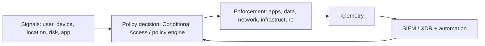

# 01 · MCRA, MCSB & Zero Trust

## Microsoft Cybersecurity Reference Architectures (MCRA)
A set of diagrams and guidance showing Microsoft security capabilities, how they integrate, and how they map to Zero Trust, multicloud, and operational models. Use it to **explain the whole estate** and to find gaps in a customer's coverage.

Architect use: map the customer's current tools to MCRA capability areas (identity, endpoint, SaaS, infrastructure, SecOps, data, OT/IoT, people), then mark overlap, gaps, and integration points.

## Microsoft Cloud Security Benchmark (MCSB)
Prescriptive, cloud-agnostic security controls and guidance, built into **Defender for Cloud** as the default security standard and mapped to frameworks such as CIS, NIST, and PCI DSS.

| Domain | Code | Architect question |
|--------|------|--------------------|
| Network security | NS | Is the network segmented and private by default? |
| Identity management | IM | Is identity the control plane (SSO, MFA, risk-based)? |
| Privileged access | PA | Is admin access JIT, least-privilege, and monitored? |
| Data protection | DP | Is data classified, encrypted, and access-controlled? |
| Asset management | AM | Do we know and govern what we run? |
| Logging & threat detection | LT | Are logs centralised and detections tuned? |
| Incident response | IR | Is response rehearsed and automated? |
| Posture & vulnerability management | PV | Is posture measured and drift remediated? |
| Endpoint security | ES | Are endpoints protected with EDR and hardened? |
| Backup & recovery | BR | Can we recover from destructive attacks? |
| DevOps security | DS | Is the pipeline and supply chain secured? |
| Governance & strategy | GS | Is there ownership, policy, and measurement? |

> Newer MCSB versions extend coverage (for example, AI security). Check the current version in the docs.

## Zero Trust
| Principle | Meaning in design |
|-----------|-------------------|
| Verify explicitly | Authenticate and authorise using all signals: identity, device, location, risk, workload |
| Use least privilege | JIT/JEA, scoped roles, risk-based adaptive access |
| Assume breach | Segment, encrypt, monitor, limit blast radius, automate response |

**Pillars**: identity · endpoints · data · applications · infrastructure · network, plus visibility/analytics and automation/orchestration across them.

## Measuring posture
- **Microsoft Secure Score** (Defender portal): score and improvement actions across identity, devices, apps, and data in the Microsoft 365 estate.
- **Defender for Cloud secure score / recommendations**: infrastructure and workload posture against MCSB and other standards.
- Architect point: scores are **prioritisation tools**, not goals. Weigh recommendation impact, effort, and business risk.

## Exam-style takeaways
- "Align to a benchmark" → MCSB through Defender for Cloud regulatory compliance.
- "Show the whole architecture / find gaps" → MCRA.
- "Evaluate posture across M365" → Secure Score; "across cloud workloads" → Defender for Cloud.
