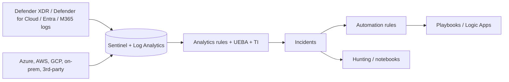

# 03 · Security Operations (SIEM, XDR, SOAR, Posture)

## Building blocks
| Capability | Service | Role |
|-----------|---------|------|
| SIEM + SOAR | **Microsoft Sentinel** | Collect, correlate, detect, investigate, automate across any source |
| XDR | **Microsoft Defender XDR** | Unified incidents across endpoint, identity, email, cloud apps; automatic attack disruption; advanced hunting |
| Cloud workload protection | **Defender for Cloud** | CSPM and workload protection |
| Generative AI assistance | **Microsoft Security Copilot** | Investigation, summarisation, guided response, agents |

> Microsoft is consolidating Sentinel and Defender XDR into the unified Defender portal. Check the current timeline and feature parity in the docs.

## Sentinel design decisions
| Decision | Guidance |
|----------|----------|
| Workspace count | Default to **one** workspace. Split only for data sovereignty, separate ownership/RBAC that cannot be met with table-level or resource-context RBAC, or distinct retention/cost boundaries |
| Data ingestion | Prefer native connectors; use Azure Monitor Agent + data collection rules; Event Hubs/CEF/Syslog for third-party sources |
| Cost control | Choose log tiers (analytics vs basic vs auxiliary) by detection value; commitment tiers for predictable volume; filter/transform at ingestion |
| Retention | Interactive vs long-term retention; meet compliance without paying analytics prices for cold data |
| Access | Azure RBAC roles (Reader, Responder, Contributor), table-level RBAC, resource-context RBAC |
| Detections | Scheduled, NRT, anomaly, fusion/ML, Microsoft-incident-creation rules; MITRE ATT&CK mapping |
| Threat intel | TI connectors, indicators, watchlists for allow/deny enrichment |

## SOAR design
- **Automation rules**: lightweight, in-platform: assign, tag, close, change severity, trigger playbooks. Use first.
- **Playbooks (Logic Apps)**: multi-step workflows and integrations (ITSM, block user, isolate device, notify).
- Use managed identity for playbook permissions; least privilege; test in non-prod.
- In Defender XDR: **automatic attack disruption** and **automated investigation & response (AIR)** reduce manual effort.

## Posture and exposure
- **Defender for Cloud**: recommendations, secure score, regulatory compliance, attack path analysis (Defender CSPM), governance rules.
- **Secure Score (Defender portal)**: M365 estate improvement actions.
- Exposure management tools show attack paths and critical assets across the estate.

## Security Copilot (architect view)
- Provisioned with security compute units (SCUs); plan capacity and who gets access.
- Uses plugins/connectors to read from Defender, Sentinel, Entra, Intune, Purview.
- Governance: role-based access, data handling review, human review of outputs. It accelerates analysts; it does not replace detection engineering.

## Exam-style takeaways
- "Automate response to a specific incident type with minimal effort" → automation rule + playbook.
- "Single pane across endpoints, identities, email, apps" → Defender XDR.
- "Multicloud + on-prem + third-party logs, custom detections" → Sentinel.
- "Reduce log cost without losing retention" → tiering, transformation, selective ingestion.
