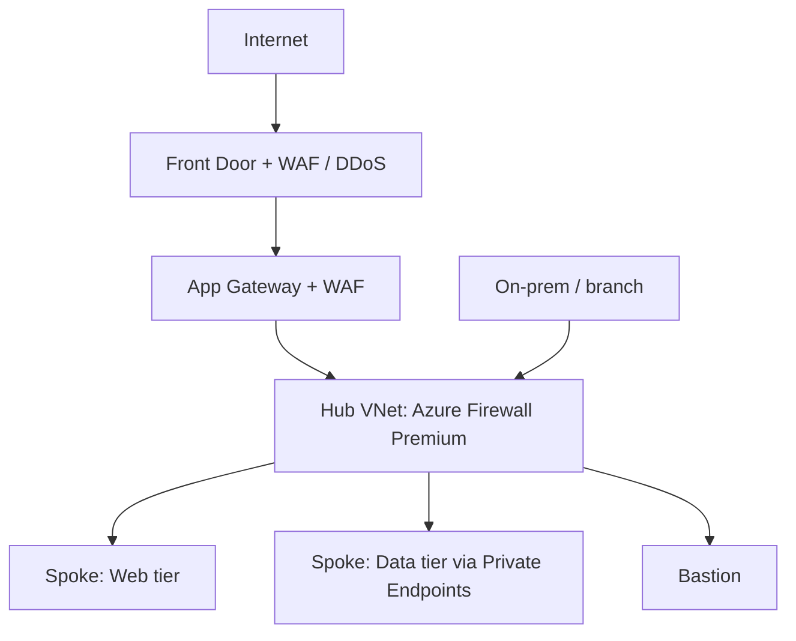

# 05 · Infrastructure, Hybrid/Multicloud & Network

## Defender for Cloud
| Layer | What it gives you |
|-------|-------------------|
| **CSPM** (foundational + Defender CSPM) | Recommendations, secure score, compliance dashboards; Defender CSPM adds attack path analysis, cloud security explorer, agentless scanning, governance |
| **CWPP** (Defender plans) | Servers, containers, storage, databases, App Service, Key Vault, APIs, AI services: threat detection and hardening |
| **DevOps security** | Posture for GitHub/Azure DevOps/GitLab repos and pipelines |
| **Multicloud** | Connectors for AWS and GCP; Arc for on-prem and other-cloud servers |

Design rule: enable **CSPM broadly** (visibility is cheap relative to risk), then enable **CWPP plans by workload criticality**.

## Servers & endpoints
- **Defender for Servers** (P1/P2) with Defender for Endpoint integration; Azure Arc for non-Azure servers.
- Hardening: Trusted Launch / confidential VMs, secure boot, disk encryption (platform-managed or customer-managed keys), Azure Update Manager for patching, file integrity monitoring.
- **Intune**: compliance policies, security baselines, endpoint security profiles (ASR, firewall, disk encryption), app protection policies for BYOD (MAM), Autopatch.
- **IoT/OT**: Defender for IoT sensors with network monitoring; segment OT; integrate into Sentinel.

## Network security design

| Need | Choice |
|------|--------|
| East-west/north-south filtering, TLS inspection, IDPS | Azure Firewall Premium |
| L7 web protection (OWASP rules, bot) | WAF on Front Door (global) or Application Gateway (regional) |
| Volumetric/protocol DDoS | DDoS Protection (network or IP protection tier) |
| Private access to PaaS | **Private Endpoint + Private DNS**; service endpoints are weaker (still public IP target) |
| Admin access to VMs without public IPs | Azure Bastion; JIT VM access via Defender for Servers |
| Micro-segmentation | NSGs, ASGs, UDRs, Azure Virtual Network Manager security admin rules |
| Branch connectivity at scale | Virtual WAN with secured hubs |
| Identity-based remote access | Entra Private Access (see [note 04](04-identity-access.md)) |

## Hybrid & multicloud principles
- One policy and posture plane: Arc + Defender for Cloud + Sentinel.
- Normalise identities (Entra as IdP, federation to AWS/GCP).
- Consistent baselines via Azure Policy (Arc-enabled) and Defender recommendations.
- Centralise logs; avoid per-cloud silo SOCs.

## Compliance in infrastructure
- Defender for Cloud regulatory compliance dashboard and custom standards.
- Azure Policy initiatives for enforcement; Purview Compliance Manager for assessments covering Microsoft 365 and cloud controls.
- Service Trust Portal for Microsoft audit reports (as evidence).

## Exam-style takeaways
- "Attack paths to crown jewels" → Defender CSPM.
- "Servers in AWS and on-prem" → Arc + Defender for Servers; AWS connector.
- "PaaS must not be reachable from internet" → private endpoint + disable public access.
- "Inspect outbound TLS traffic" → Azure Firewall Premium.
